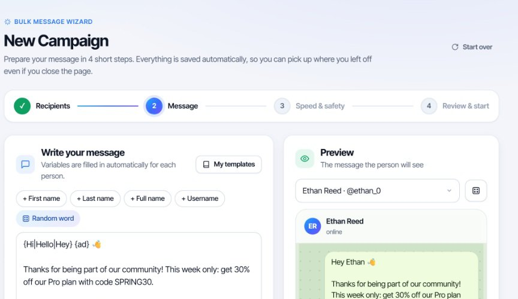
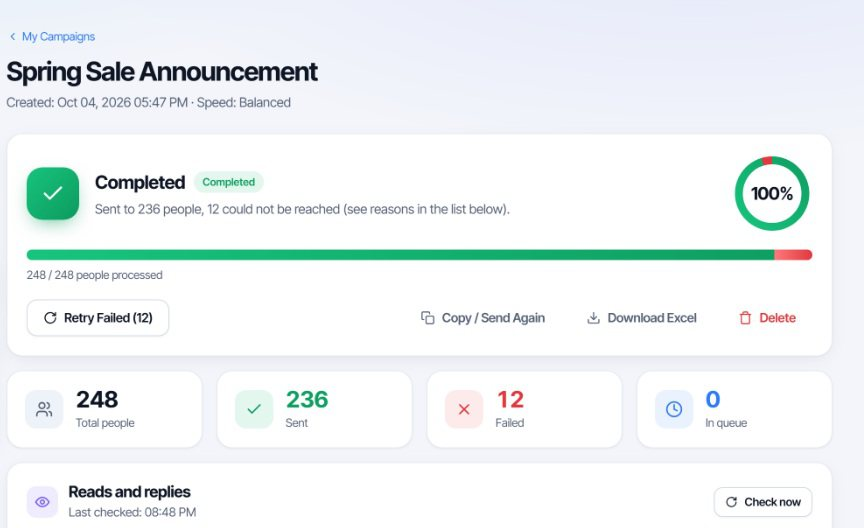
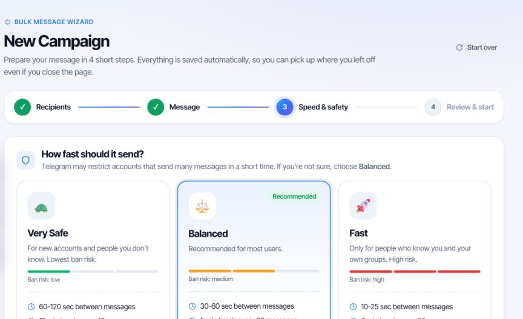

# TeleSendly: Telegram Bulk Sender, Group Member Export and Member Adder for Chrome

TeleSendly is a Chrome extension that works inside Telegram Web with your own account. It sends a personalised message to a list of people one at a time, exports the member list of a group to Excel or CSV, and invites people into a group or channel you manage. There is no bot, no API key and nothing to install besides the extension.

**[Install from the Chrome Web Store](https://chromewebstore.google.com/detail/omcalhkfohpiogioealeighacalkjigo?utm_source=github&utm_medium=readme&utm_campaign=telesendly)** | **[Full guide and FAQ](https://www.addonschrome.com/extensions/telesendly-telegram-bulk-sender-scraper-member-adder.html?utm_source=github&utm_medium=readme&utm_campaign=telesendly)**

This repository is the public home for TeleSendly documentation, release notes and the issue tracker. The extension itself is distributed through the Chrome Web Store.

## What it does

### Bulk messaging

- Pick recipients from your own chats and groups, or paste usernames or phone numbers
- Variables for name, first name and username, so each person gets their own copy
- Preview any recipient's version before a single message leaves
- Attach photos, videos and files
- Schedule a campaign, or keep sending inside working hours only

### Member export

- Collect the member list of a group into a table: name, username, phone number where the person has made it visible, and last seen
- Filters for bots, admins, has username, has photo, Premium and last seen
- Download as Excel or CSV

### Member adder

- Invite people into groups and channels you manage, one by one, with a gap between each invite
- Existing members are skipped automatically
- A report of who joined and, for everyone else, the reason it did not work

### Reports

- Live progress while a campaign runs, with the reason beside anyone who could not be reached
- Read and reply tracking
- Retry the failures in one click and download the report as Excel

## Speed and account safety

- Three speed profiles: Very Safe (60 to 120 seconds between messages), Balanced (30 to 60) and Fast (10 to 25)
- Batch pauses and a daily limit you choose
- Account health check through Telegram's own SpamBot
- The campaign pauses itself if Telegram asks you to slow down

No tool can promise that an account will never be limited.

## How to use it

1. Install TeleSendly from the [Chrome Web Store](https://chromewebstore.google.com/detail/omcalhkfohpiogioealeighacalkjigo?utm_source=github&utm_medium=readme&utm_campaign=telesendly) and sign in with Google.
2. Open Telegram Web and log in to your own Telegram account the way you always do.
3. Choose your recipients or collect a member list, write one message, pick a speed and start. Everything runs in your browser while the tab is open.

The [full guide](https://www.addonschrome.com/extensions/telesendly-telegram-bulk-sender-scraper-member-adder.html?utm_source=github&utm_medium=readme&utm_campaign=telesendly) explains each step.

## Read this before you use it

Telegram's Terms of Service prohibit spam, and Telegram restricts accounts that message or add people who did not ask for it.

- Message people who expect to hear from you: your customers, your community, members of groups you run
- Do not add people to a group they did not ask to join
- A member list is other people's personal data. Privacy laws such as GDPR apply to names, usernames and phone numbers
- Start slow with a new account and keep the daily limit low

## Privacy

Messages, contacts and collected member lists stay on your computer and are not uploaded. TeleSendly works inside the Telegram Web session you opened yourself. It does not ask for your Telegram password, login code or two-step verification. Signing in with Google sends only your account name and email address, so your licence can be recognised.

## Limits

TeleSendly runs on Telegram Web in desktop Chromium browsers such as Chrome, Edge, Brave and Opera. Telegram Desktop and the mobile apps are not supported. It cannot reach a private group you are not a member of.

## Pricing

TeleSendly is free to install from the Chrome Web Store.

## Screenshots

## Support and feedback

Found a bug or want a feature? [Open an issue](../../issues) in this repository. Please include your Chrome version and the steps that led to the problem.

## Disclaimer

TeleSendly is an independent tool. It is not affiliated with, endorsed by or sponsored by Telegram. Telegram is a trademark of its owner. You are responsible for using it within Telegram's Terms of Service and the laws that apply to you.

---

Built and maintained by [Addons Chrome](https://www.addonschrome.com/?utm_source=github&utm_medium=readme&utm_campaign=telesendly).
